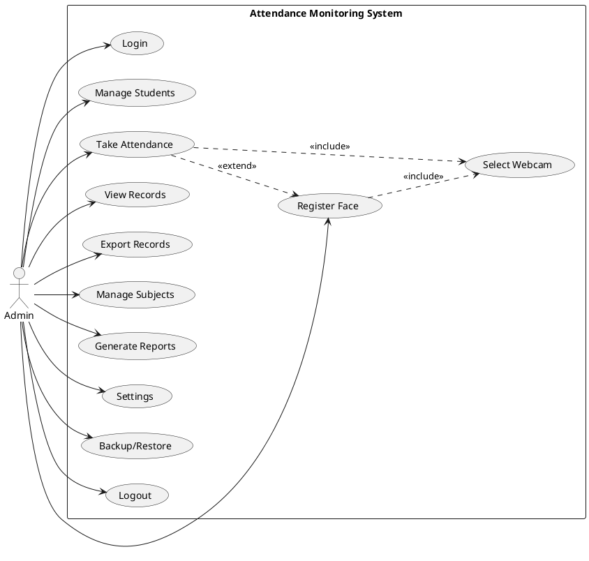
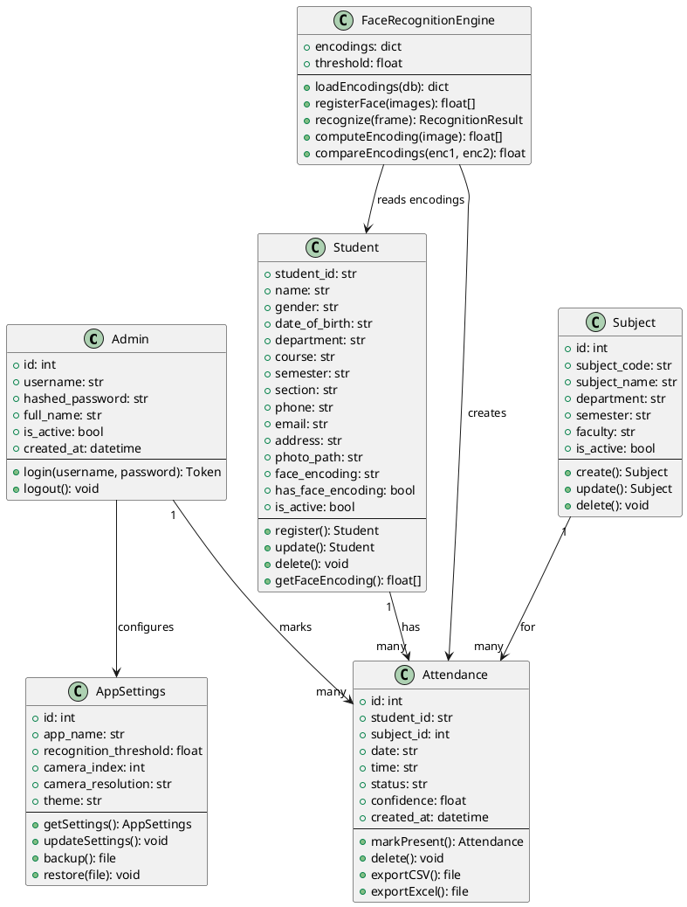
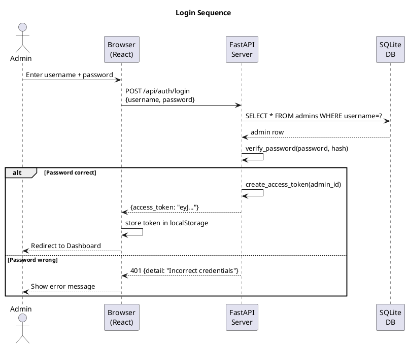
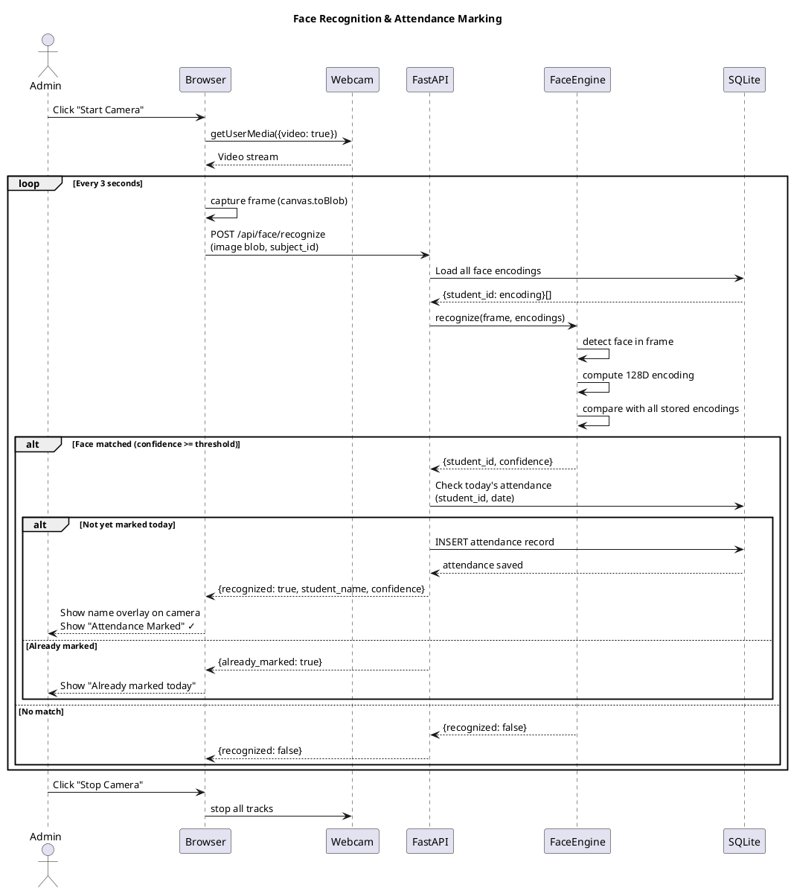
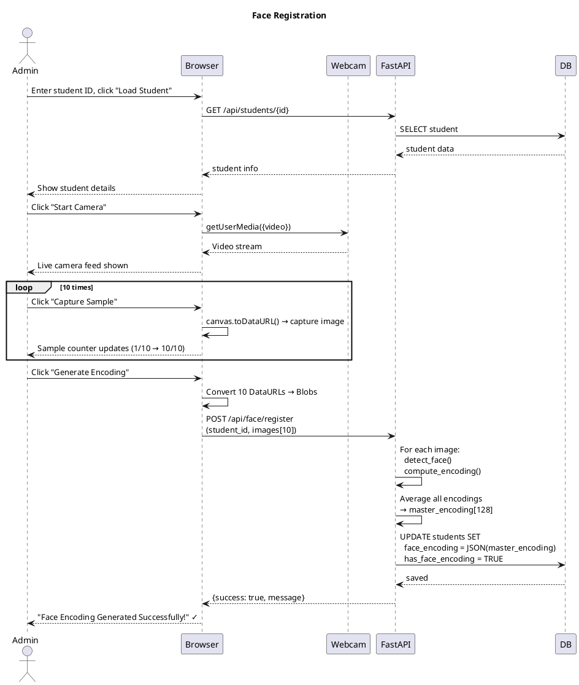
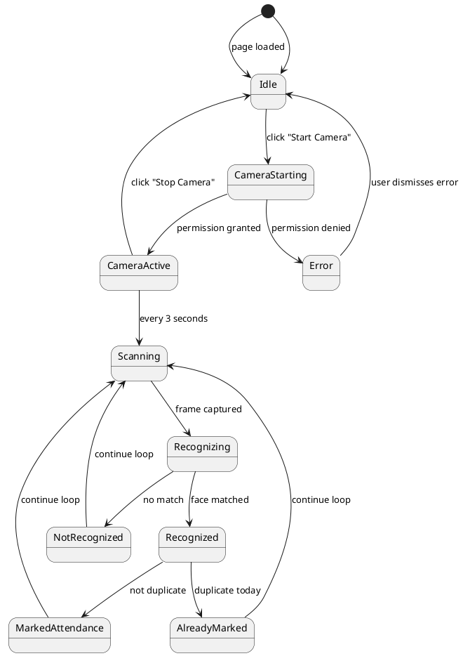

# UML DIAGRAMS + DFD + ER DIAGRAMS

**Project:** Attendance Monitoring System Using Face Recognition for Students  
**Version:** 1.0 | **Date:** August 2025

> **Note:** All diagrams below are expressed in structured text/ASCII notation. Render them using PlantUML, draw.io, Lucidchart, or include them in Word as described.

---

## PART A: UML DIAGRAMS

---

## A.1 Use Case Diagram

```
                    ┌──────────────────────────────────────────────────┐
                    │         Attendance Monitoring System              │
                    │                                                    │
                    │  ┌──────────────────────────────────────────┐     │
                    │  │            <<Admin Actor>>                │     │
                    │  │                                            │     │
           ┌────────┤  │  ○ Login to System                        │     │
           │ Admin  ├─►│  ○ Manage Students (CRUD)                 │     │
           │(Faculty│  │  ○ Register Student Face                   │     │
           │  )     │  │  ○ Select Webcam Device                   │     │
           └────────┤  │  ○ Take Attendance (Auto-recognition)     │     │
                    │  │  ○ View Attendance Records                 │     │
                    │  │  ○ Filter/Search Records                   │     │
                    │  │  ○ Export Attendance (CSV/Excel)           │     │
                    │  │  ○ Manage Subjects                         │     │
                    │  │  ○ Generate Reports                        │     │
                    │  │  ○ Configure System Settings               │     │
                    │  │  ○ Backup/Restore Database                 │     │
                    │  │  ○ Logout                                  │     │
                    │  └──────────────────────────────────────────┘     │
                    │                                                    │
                    │  ┌──────────────┐                                 │
                    │  │<<System>>    │                                  │
                    │  │Face Recog.   │                                  │
                    │  │Engine        │                                  │
                    │  └──────────────┘                                 │
                    └──────────────────────────────────────────────────┘
```

**PlantUML Code:**


---

## A.2 Class Diagram



---

## A.3 Sequence Diagram — Login



---

## A.4 Sequence Diagram — Face Recognition & Attendance Marking



---

## A.5 Sequence Diagram — Face Registration



---

## A.6 Activity Diagram — Take Attendance

```
START
  │
  ▼
Open Take Attendance Page
  │
  ▼
Select Webcam Device (from dropdown)
  │
  ▼
Select Subject (optional)
  │
  ▼
Click "Start Camera"
  │
  ▼
Camera Activated? ──No──► Show Error Message ──► STOP
  │
  Yes
  │
  ▼
┌────────────────────┐
│  Auto-scan loop    │◄─────────────────────────┐
│  (every 3 seconds) │                          │
└────────┬───────────┘                          │
         │                                      │
         ▼                                      │
    Capture Frame                               │
         │                                      │
         ▼                                      │
    Send to API                                 │
         │                                      │
         ▼                                      │
    Face Detected? ──No──► Mark unrecognized ───┤
         │                                      │
        Yes                                     │
         │                                      │
         ▼                                      │
    Confidence >= Threshold? ──No──────────────►│
         │                                      │
        Yes                                     │
         │                                      │
         ▼                                      │
    Already marked today? ──Yes──► Show msg ───►│
         │                                      │
        No                                      │
         │                                      │
         ▼                                      │
    Mark Attendance in DB                       │
         │                                      │
         ▼                                      │
    Show "Attendance Marked" ───────────────────┘
         │
         ▼
    Admin clicks "Stop Camera"
         │
         ▼
    Camera Stopped
         │
         ▼
         END
```

---

## A.7 State Diagram — Attendance Session



---

## PART B: DATA FLOW DIAGRAMS (DFD)

---

## B.1 Level 0 DFD (Context Diagram)

```
                   ┌─────────────────────────────────────┐
                   │                                       │
  Admin ──────────►│   Attendance Monitoring System        │◄──── Webcam
                   │                                       │
  Admin ◄──────────│   (all input/output flows)            │────► Database
                   │                                       │
                   └─────────────────────────────────────┘
```

**External Entities:** Admin (User), Webcam (Hardware)  
**System:** Attendance Monitoring System  
**Data Flows:**
- Admin → System: Login credentials, student data, face images, attendance commands
- System → Admin: Dashboards, recognition results, reports, exports
- Webcam → System: Video frames
- System → Database: Read/Write all persistent data

---

## B.2 Level 1 DFD

```
Admin ──login──► [1.0 Authentication] ──token──► all processes
                        │
                        ▼
                  [Admin DB: admins]

Admin ──student data──► [2.0 Student Management] ──CRUD──► [Student DB]
Admin ◄── student list──

Admin ──images──► [3.0 Face Registration] ──encodings──► [Student DB]
                        │
                        ▼
                 [Face Engine: dlib]

Webcam ──frames──► [4.0 Face Recognition] ──read encodings──► [Student DB]
Admin ◄── result──      │
                        │──mark attendance──► [5.0 Attendance Management]
                                                      │
                                                      ▼
                                              [Attendance DB]

Admin ──filters──► [5.0 Attendance Management] ──records──► Admin
Admin ──export──► [5.0] ──CSV/Excel──► Admin

Admin ──params──► [6.0 Report Generation] ──read──► [Attendance DB]
Admin ◄── report──

Admin ──settings──► [7.0 Settings Management] ──CRUD──► [Settings DB]
```

---

## B.3 Level 2 DFD — Face Recognition (Expanded)

```
Webcam ──frame──► [4.1 Capture Frame]
                        │
                        ▼
                 [4.2 Detect Face]  ──no face──► discard
                        │
                       face region
                        │
                        ▼
                 [4.3 Compute Encoding] ──128D vector──►
                        │
                        ▼
                 [4.4 Load DB Encodings] ◄── [Student DB]
                        │
                        ▼
                 [4.5 Compare Encodings]
                        │
              ┌─────────┴──────────┐
           match                no match
              │                      │
              ▼                      ▼
         [4.6 Get Confidence]    [4.7 Return
              │                   Not Recognized]
              ▼
         [4.8 Check Duplicate]
              │
         ┌────┴────┐
      new today  already
              │       │
              ▼       ▼
         [4.9 Mark  Return
          Attendance] Already
                     Marked
```

---

## PART C: ENTITY-RELATIONSHIP (ER) DIAGRAM

---

## C.1 ER Diagram (Chen Notation)

```
┌──────────────────────────────────────────────────────────────────┐
│                                                                    │
│    [admin_id]  [username]  [password]  [full_name]                │
│         │          │           │           │                       │
│         └──────────┴─────┬─────┴───────────┘                      │
│                     ┌────┴────┐                                    │
│                     │  ADMIN  │                                    │
│                     └─────────┘                                    │
│                                                                    │
│  [student_id] [name] [gender] [dept] [course] [sem] [face_enc]    │
│        │         │      │       │       │       │        │         │
│        └─────────┴──────┴───────┴───────┴───────┴────────┘        │
│                              │                                     │
│                        ┌─────┴──────┐                             │
│                        │  STUDENT   │                             │
│                        └─────┬──────┘                             │
│                              │                                     │
│                         1 ◄──┘──► N                               │
│                              │                                     │
│                    ┌─────────┴──────────┐                         │
│                    │  HAS_ATTENDANCE    │                          │
│                    └─────────┬──────────┘                         │
│                              │                                     │
│                        ┌─────┴──────┐                             │
│                        │ ATTENDANCE │                             │
│                        └─────┬──────┘                             │
│      [id][date][time]        │    [status][confidence]            │
│            │                 │           │                         │
│            └─────────────────┘───────────┘                        │
│                              │                                     │
│                         N ◄──┘──► 1                               │
│                              │                                     │
│                    ┌─────────┴──────────┐                         │
│                    │   FOR_SUBJECT      │                          │
│                    └─────────┬──────────┘                         │
│                              │                                     │
│                        ┌─────┴──────┐                             │
│                        │  SUBJECT   │                             │
│                        └────────────┘                             │
│                                                                    │
│  [id][subject_code][subject_name][department][semester][faculty]  │
│                                                                    │
└──────────────────────────────────────────────────────────────────┘
```

---

## C.2 ER Diagram — Crow's Foot Notation

```
admins                    students
┌─────────────────┐       ┌─────────────────────────────┐
│ id (PK)         │       │ student_id (PK)              │
│ username        │       │ name                         │
│ hashed_password │       │ gender                       │
│ full_name       │       │ date_of_birth                │
│ is_active       │       │ department                   │
│ created_at      │       │ course                       │
└─────────────────┘       │ semester                     │
                          │ section                      │
                          │ phone                        │
                          │ email                        │
                          │ photo_path                   │
                          │ face_encoding                │
                          │ has_face_encoding            │
                          │ is_active                    │
                          └──────────────┬──────────────┘
                                         │
                                         │ 1 ──────────── N
                                         │
subjects                             attendance
┌─────────────────┐       ┌─────────────────────────────┐
│ id (PK)         │       │ id (PK)                      │
│ subject_code    │       │ student_id (FK → students)   │
│ subject_name    ├──1─N──│ subject_id (FK → subjects)   │
│ department      │       │ date                         │
│ semester        │       │ time                         │
│ faculty         │       │ status                       │
│ is_active       │       │ confidence                   │
└─────────────────┘       │ created_at                   │
                          └─────────────────────────────┘

app_settings (singleton)
┌─────────────────────────────────┐
│ id (PK)                         │
│ app_name                        │
│ recognition_threshold           │
│ camera_index                    │
│ camera_resolution               │
│ theme                           │
└─────────────────────────────────┘
```

---

## C.3 ER Diagram Relationships Table

| Relationship | Type | Description |
|-------------|------|-------------|
| Student — Attendance | 1 : N (One-to-Many) | One student has many attendance records |
| Subject — Attendance | 1 : N (One-to-Many) | One subject has many attendance records |
| Admin — System | 1 : N (One-to-Many) | One admin manages all records |
| Attendance — Date | N : 1 | Many records for same date |

---

*Document Version: 1.0 | Date: August 2025*
